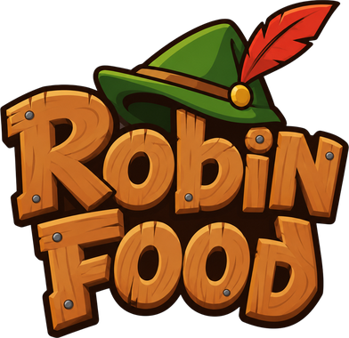

<div align="center">



# Robin Food: Panah Matematika Game 🏹🍕

**Game Edukasi Interaktif Berbasis Scratch 3.0**

*Proyek Tugas Kuliah — Gamifikasi Media Pembelajaran Matematika Aritmatika*

[](https://scratch.mit.edu/)
[](https://scratch.mit.edu/projects/editor/)
[](#informasi-proyek)

</div>

---

## 📌 Tentang Proyek

**Robin Food** adalah sebuah game edukasi matematika interaktif bertema petualangan yang dikembangkan menggunakan **Scratch 3.0**. Proyek ini disusun sebagai **Tugas Kuliah** untuk mengeksplorasi konsep gamifikasi dalam media pembelajaran matematika, melatih kecepatan berhitung, serta ketangkasan motorik pemain.

Permainan ini dijalankan langsung di peramban web (*web browser*) melalui platform resmi **[Scratch MIT (scratch.mit.edu)](https://scratch.mit.edu/)**.

---

## 🎯 Konsep & Gameplay

Pemain mengendalikan **Robin** si pemanah legendaris. Di bagian bawah layar, terdapat papan busur panah yang memuat angka sasaran (**TARGET**). Dari langit, berjatuhan aneka makanan lezat (*Pizza, Burger, dan Taco*) yang masing-masing membawa soal operasi matematika di atasnya.

Pemain harus:
1. Melihat dan mengingat angka **TARGET** yang tertera pada papan.
2. Menghitung secara kilat operasi matematika pada makanan yang sedang meluncur jatuh.
3. Mengarahkan busur dan menembak makanan yang **hasil perhitungannya tepat sama dengan nilai TARGET**.

---

## 🏆 Rincian Level Permainan

Game ini terdiri atas **3 level bertingkat** dengan sistem buka kunci (*level unlock progression*). Setiap level berfokus pada operasi aritmatika yang berbeda dan memiliki tantangan tersendiri:

| Level | Fokus Operasi | Angka Target | Jumlah Makanan per Wave | Target Menang | Kecepatan Jatuh | Latar Suasana |
| :---: | :--- | :---: | :---: | :---: | :---: | :---: |
| **Level 1** | **Penjumlahan & Pengurangan** (`+` dan `-`) | Acak `1 - 50` | 3 Makanan | **15 Skor** | Normal (`-2` s.d. `-5`) | Pagi Hari (*Latar Belakang*) |
| **Level 2** | **Perkalian** (`x`) | Hasil kali `1-10` | 4 Makanan | **20 Skor** | Cepat (`-4` s.d. `-8`) | Siang Terik (*Latar Siang*) |
| **Level 3** | **Pembagian** (`:`) | Acak `1 - 10` | 4 Makanan | **25 Skor** | Bertahap (`-2` s.d. `-5`) | Senja Sore (*Latar Sore*) |

### 1. Level 1: Penjumlahan & Pengurangan (`+` dan `-`)
- **Mekanik**: Melatih kalkulasi dasar penjumlahan dan pengurangan dua bilangan.
- **Gelombang Sasaran**: 3 makanan meluncur per ronde (Pizza, Burger, Taco).
- **Syarat Menang**: Kumpulkan **15 poin**.

### 2. Level 2: Perkalian (`x`)
- **Mekanik**: *"Tembak yang hasil kalinya = TARGET"*. Angka target dibentuk dari perkalian tabel matematika $1 \times 1$ hingga $10 \times 10$.
- **Gelombang Sasaran**: 4 makanan meluncur per ronde dengan variasi posisi dinamis.
- **Tingkat Kesulitan**: Kecepatan jatuh lebih tinggi (awal -4, maksimal -8) dengan jeda antar kemunculan hanya 0.8 detik.
- **Syarat Menang**: Kumpulkan **20 poin**.

### 3. Level 3: Pembagian (`:`)
- **Mekanik**: *"Tembak yang hasil baginya = TARGET"*. Soal pembagian yang habis dibagi menghasilkan angka target (1 s.d. 10).
- **Gelombang Sasaran**: 4 makanan meluncur per ronde.
- **Syarat Menang**: Kumpulkan **25 poin** untuk menamatkan permainan.

---

## ❤️ Sistem Nyawa & Aturan Main

Di setiap level, pemain dibekali **3 Nyawa**:
- ❌ **Panah jawaban salah**: Nyawa berkurang **-1**.
- ⚠️ **Jawaban benar lolos ke batas bawah**: Nyawa berkurang **-1**.
- 🛡️ **Jawaban salah lolos ke bawah**: Nyawa **TIDAK** berkurang (biarkan makanan berjawaban salah jatuh!).
- ☠️ **Game Over**: Jika nyawa habis (`Nyawa < 1`).
- ⚡ **Dynamic Speed**: Setiap kali tembakan berhasil mengenai sasaran yang tepat, skor bertambah +1 dan kecepatan jatuh makanan akan meningkat bertahap (+0.2).

---

## 🎮 Kontrol Permainan

| Aksi | Tombol / Input |
| :--- | :--- |
| **Membidik Busur** | Gerakkan **Mouse** (Arah kursor) |
| **Menembak Panah** | Tekan **Spasi** (*Spacebar*) atau **Klik Kiri Mouse** |
| **Navigasi Menu** | **Klik Kiri Mouse** pada tombol (Mulai, Level, OK, Kembali) |

---

## 🚀 Cara Menjalankan Game di Scratch (scratch.mit.edu)

Proyek ini disimpan dalam format berkas proyek Scratch 3.0 (**`.sb3`**). Anda dapat menjalankannya dengan mudah melalui browser:

1. **Unduh Berkas Proyek**:
   - Clone repositori ini atau unduh berkas [`Robin_Food_Full (1).sb3`](Robin_Food_Full%20(1).sb3).
     ```bash
     git clone https://github.com/yunikyuroidah/RobinPanahMatematikaGame.git
     ```

2. **Kunjungi Scratch Web Editor**:
   - Buka peramban (Chrome, Edge, Firefox, dll.) dan buka: **[https://scratch.mit.edu/projects/editor/](https://scratch.mit.edu/projects/editor/)**

3. **Muat Proyek (*Load*)**:
   - Klik menu **File** di pojok kiri atas jendela Scratch.
   - Pilih opsi **Load from your computer** (atau *Unggah dari komputer Anda*).
   - Arahkan dan pilih berkas `Robin_Food_Full (1).sb3`.

4. **Mainkan Game**:
   - Klik tombol **Bendera Hijau (Green Flag)** di pojok atas panggung (*stage*).
   - Pilih menu Mulai, pilih level yang terbuka, baca papan aturan, lalu klik **OK** untuk mulai memanah!

---

## 📁 Struktur Berkas Repositori

```plaintext
RobinPanahMatematikaGame/
├── assets/
│   ├── logo.png               # Banner & logo Robin Food
│   ├── aturan_level_1.png     # Papan aturan Level 1
│   ├── aturan_level_2.png     # Papan aturan Level 2
│   └── aturan_level_3.png     # Papan aturan Level 3
├── Robin_Food_Full (1).sb3    # Berkas proyek game utama Scratch 3.0
├── Robin_Food_Full.sb3.zip    # Berkas cadangan arsip
└── README.md                  # Dokumentasi proyek
```

---

## 🎓 Informasi Proyek

- **Nama Game**: Robin Food: Panah Matematika
- **Kategori**: Tugas Kuliah — Gamifikasi Media Pembelajaran Matematika
- **Engine/Environment**: [Scratch MIT (MIT Media Lab)](https://scratch.mit.edu/)
- **Author**: [yunikyuroidah](https://github.com/yunikyuroidah)
